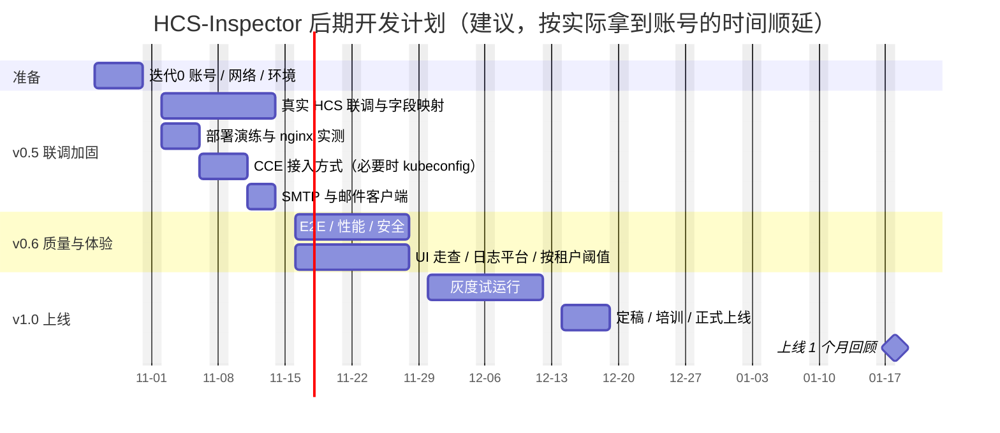

# HCS-Inspector 后期开发方案（v0.4 → v1.0 及以后）

> 基线：**v0.4.0**（2026-10-23）。本文给出从当前版本到正式上线（v1.0）以及上线后的开发计划：各版本目标、工作包、验收标准、工作量估算、待办总表与风险。
> 进度以《开发 Checklist》为准；实现细节见《架构文档》《开发文档》，部署与联调操作见《部署运维手册》《联调手册》。

## 1 现状

| 维度 | v0.4.0 状态 |
| --- | --- |
| 功能 | 8 个巡检任务 + 14 类资源台账 + CCE 容器事件；告警闭环（去重、升级、未认领升级、维护与静默、平台自身告警）；通知（路由 / 联系人维护、模拟匹配、SMTP 测试）；报表（日 / 周 / 月 / 台账，按租户或合并）；系统管理 8 个页签；态势大屏、手机认领页 |
| 规模 | 97 个接口、28 个权限点、4 个内置角色、25 张表、35 条内置规则 + 4 条平台规则 |
| 验证 | Mock HCS 8.5.1（两个租户，账号密码 + CES / AK/SK + Prometheus）；102 个自动化用例；ruff、mypy、vue-tsc；页面实测截图 51 张（v0.3 23 张 + v0.4 28 张） |
| 部署 | 单机 docker compose 部署包（`deploy/`）、运维命令（安装 / 升级 / 回滚 / 备份 / 恢复 / 自检 / 探测 / 离线包）、CI（check → build → package） |
| **未验证** | ① 真实 HCS 8.5.1 接口字段；② 镜像构建与部署脚本的实际运行（开发环境无 Docker，仅语法检查）；③ nginx 配置（未做 `nginx -t`）；④ 企业 SMTP 与邮件客户端 |
| Checklist | 115 / 164 项完成；未完成项集中在联调、部署演练、质量专项和试运行 |

结论：**功能开发基本完成，后续重点是“接真环境、做演练、补质量、试运行”**，开发量主要来自联调中发现的字段差异和少量补充功能（kubeconfig 接入、按租户阈值等）。

## 2 路线图

| 阶段 | 建议时间 | 目标 | 退出标准 |
| --- | --- | --- | --- |
| 迭代 0 准备 | 第 1 周（10-26 ~ 10-30） | 两个租户的只读账号 / AK/SK、网络、测试机、构建机、SMTP 账号就绪 | 测试机上 `make probe` 能完成两个租户的认证 |
| **v0.5 联调加固** | 第 2–3 周（11-02 ~ 11-13） | 真实 HCS 字段映射修正、CCE 接入方式确定、部署全流程演练、SMTP 联调 | 两个租户 `make probe` 无必需字段缺失；台账数量与控制台一致；测试机完成安装 → 升级 → 回滚 → 恢复；邮件送达且客户端显示正常 |
| **v0.6 质量与体验** | 第 4–5 周（11-16 ~ 11-27） | E2E、性能、安全、UI 走查、日志平台接入、按租户阈值、统计口径确认 | CI 含 E2E；列表查询 P95 < 1 秒；无高危漏洞；UI 走查问题清零 |
| **v1.0 试运行与上线** | 第 6–8 周（11-30 ~ 12-18） | 灰度试运行 2 周、定稿配置、值班手册、培训、正式上线 | 试运行期间无漏报 P1 / P2，误报率运维组认可；日报连续一周按时送达 |
| v1.x 持续迭代 | 上线后按需 | ManageOne 北向告警、CTS、更多通知渠道、值班排班、Webhook / ITSM 等 | 按需求评审排期 |

人力假设：后端 1 人、前端 0.5 人、运维 / 值班代表配合联调与试运行。下文估算为开发人天，不含等待局点开通权限的时间。

## 3 v0.5 联调加固（第 2–3 周）

### 3.1 真实 HCS 8.5.1 接入与字段映射（6–8 人天）

1. 两个租户分别录入：一个走 IAM 账号密码（Token），一个走 AK/SK 签名；验证时钟偏差（签名要求主机与 HCS 时间差在 15 分钟内，部署主机配置 NTP）、项目级接口的 `X-Project-Id`、IAM 接口的 `X-Domain-Id`。
2. `make probe TENANT=<编码>`（可用 `ONLY=` 只探测部分服务）逐个调用 22 个接口 + IAM + CES，核对必需 / 可选字段缺失与状态取值分布；脱敏报告（`exports/probe-<编码>.json`）存档为联调记录。
3. 修正映射：巡检采集器 `app/collectors/*.py`、台账 `app/ledger/fetchers.py`、容器事件 `app/k8s/`、探测清单 `app/tools/probe.py`；状态取值有差异时同步修改规则 YAML。
4. **每个差异都同步到 `mock_hcs/` 并补一个测试用例**，保证 Mock 与真实接口一致、后续不回退。
5. API 版本与分页：确认各服务实际版本（v1 / v2 / v3）与分页方式（offset / marker / page），在 Endpoint 模板与分页器中适配。
6. 指标来源：CES 确认 ECS 的 CPU / 内存 / 磁盘指标名与维度（内存、磁盘通常依赖主机 Agent），无数据时规则不误报；Prometheus 确认 node_exporter 的 `instance` 标签与 ECS（IP / ID）的对应关系。

验收：两个租户连通性测试全部通过；`make probe` 退出码 0（无 FAIL；WARN 只允许出现在确认不具备的可选能力上）；台账「立即同步」后 14 类资源数量与 HCS 控制台一致；连续 24 小时无 429 和认证失败。

### 3.2 CCE 集群 K8s API 接入方式（确认 0.5 人天；需要时开发 3 人天）

- 先确认经 CCE 网关 `https://{cluster_id}.cce.{region}.{domain}` 用租户 Token / AK/SK 访问 K8s API 是否可行（`make probe TENANT=<编码> ONLY=k8s.pods,k8s.events`，WARN 表示不可用）。
- 不支持时实现 **kubeconfig 模式**：
  - 每个集群一条访问配置：apiserver 地址、ServiceAccount Token、CA 证书；AES-256-GCM 加密入库（新表 `cce_cluster_access`，迁移 0004）。
  - `KubeApi` 抽出传输层：现有“CCE 网关 + `HcsClient`”与新增“直连 apiserver（httpx + Bearer + CA）”两种实现，按集群配置选择；采集、分类、聚合逻辑不变。
  - 「租户接入」增加「集群访问」：粘贴 kubeconfig 或填写地址 / Token / CA，提供“测试连接”。
  - 随文档提供只读 RBAC 样例：ClusterRole（pods / events / namespaces 的 get、list；背压探针另需 pods/proxy 的 get）+ ServiceAccount + ClusterRoleBinding。

### 3.3 API 调用量评估与限流（1.5 人天）

- 估算：每租户每小时调用量 ≈ Σ（3600 ÷ 任务周期 × 每次运行的调用数）；每次运行的调用数在「巡检任务 → 最近运行」（`inspection_run.api_calls`）可直接查看。
- 重点关注 `dgc_realtime_status`：按作业逐个查询状态，实时作业多时调用量最大（例：100 个作业、60 秒周期 ≈ 6000 次 / 小时 / 工作空间）。处理顺序：核对作业列表接口是否已带状态（有则去掉逐个查询）→ 周期调到 120–300 秒 → 只纳管需要的工作空间。
- 开发项：
  - 每服务 QPS 目前是代码常量（`app/hcs/factory.py` 的 `DEFAULT_QPS`：多数服务 5、CES 和 K8s 10），改为可在「系统设置」按服务调整。
  - `/metrics` 增加 `hcs_api_calls_total{tenant,service,code}`，配合 Prometheus 观察调用量与错误码。
- 与局点确认 API 网关限额（每租户 / 每 AK 的 QPS 与日调用量），写入《联调手册》。

### 3.4 部署全流程演练与 nginx 实测（2–3 人天）

1. 构建机：按《部署运维手册》第 3 章构建镜像并生成离线包（`make bundle`），核对 `SHA256SUMS`。
2. 测试机：`make install` → 冒烟（登录、连通性测试、立即执行、收到测试邮件）→ 构建一个新版本（如 0.5.0-rc2）执行 `make upgrade` → `make rollback` 回到旧版本 → 在另一台空机器上用备份执行 `make restore`（新主机恢复），记录 RTO。
3. nginx：容器内 `nginx -t`；白名单外地址访问返回 403；`/metrics` 默认拒绝；HTTPS 叠加配置可用；SSE 经 nginx 连续保持 30 分钟不断流。
4. 修复演练中发现的脚本问题，结果写回《部署运维手册》。

### 3.5 SMTP 联调与邮件客户端走查（2 人天）

- 企业 SMTP：端口（25 / 465 / 587）、STARTTLS 或 SSL、内部 CA、认证方式、发件人白名单、单封收件人数量上限；「通知管理 → SMTP 测试」逐项验证。
- 退信：平台目前只记录 SMTP 投递结果，退信（异步 NDR）不回写；如需要，在 v1.x 增加退信邮箱解析。
- 客户端走查：Outlook（Windows 桌面版按 Word 引擎渲染，重点看表格和按钮）、Foxmail、手机邮件（iOS / Android）；手机经内网或 VPN 打开 H5 认领页。
- `INSPECTOR_BASE_URL` 配置为正式控制台地址（邮件链接前缀）。

### 3.6 规则首轮评审（1 人天，值班代表参与）

- 逐条过 35 条内置规则的阈值、级别、防抖次数和处置步骤；按局点流程修订 Runbook。
- 记录两个租户需要不同阈值的规则，作为 v0.6“按租户阈值”的输入。

**v0.5 交付**：v0.5.0 版本（含字段映射修正、mock_hcs 同步、QPS 可配置、API 调用量指标，必要时含 kubeconfig 模式）；联调记录；更新后的《部署运维手册》《联调手册》。

## 4 v0.6 质量与体验（第 4–5 周）

| 工作包 | 内容 | 验收 | 估算 |
| --- | --- | --- | --- |
| 前端 E2E | Playwright 覆盖：登录、租户切换、认领 / 关闭告警、快速静默、编辑台账与 Excel 导入、生成并发送报表、按角色校验按钮可见性；在 CI 中用 demo 叠加（Mock HCS + Mailpit）运行 | CI 新增 e2e 阶段并全绿 | 4 人天 |
| 性能 | 造数工具生成两个租户合计 5000 个资源、10 万条告警 / 事件；测台账同步耗时；告警、台账、容器事件列表 P95；`EXPLAIN` 检查慢查询并补索引 | P95 < 1 秒；同步 < 5 分钟 | 2 人天 |
| 安全 | `pip-audit`、`npm audit`、镜像漏洞扫描（Trivy 等）接入 CI；补越权用例（跨租户访问、绕过按钮直接调接口、静默 / 采集开关越权）；日志脱敏检查（AK/SK、口令、Token 不出现在日志） | 无高危；越权用例全部 403 | 2 人天 |
| 按租户阈值 | 启用规则的 `scope` 字段（已预留，当前评估时未使用）：同一规则可按租户 / 资源覆盖阈值；规则页显示覆盖项 | 两个租户可配置不同阈值，试运行规则覆盖生效 | 2 人天 |
| UI 走查 | 1280 / 1440 / 1920 三种宽度；值班室大屏实机投屏；空数据 / 异常态；对照设计令牌修正样式 | 走查问题清单全部关闭 | 2 人天 |
| 日志平台 | 容器 stdout 已是 JSON（含 `request_id`、`tenant`）；按公司平台（ELK / Loki）配置采集（docker 日志驱动或 Filebeat / Promtail），提供检索示例 | 能按 `request_id` 检索一次请求的全部日志 | 1 人天 |
| 容器事件口径 | 与业务方确认背压判定：事件关键字、探针指标（Flink 反压、Kafka 消费积压）和阈值；大集群（> 2000 Pod）压测，必要时改为 list + watch 增量采集 | 口径确认记录；大集群单次采集 < 30 秒 | 1–3 人天 |
| 统计口径 | 与运维组确认 MTTA / MTTR、认领率、巡检成功率、健康分的计算方式，必要时调整报表 | 口径写入报表说明 | 0.5 人天 |
| 离线接口文档 | `/api/docs` 目前从 CDN 加载 Swagger UI，改为随镜像打包静态资源 | 离线环境可打开 | 0.5 人天 |

**v0.6 交付**：v0.6.0；CI 增加 e2e 与安全扫描阶段；性能与安全报告。

## 5 v1.0 试运行与上线（第 6–8 周）

1. **测试环境接入两个真实租户**（只读账号 / 只读 AK/SK），按《联调手册》第 8 章分批放开采集开关。
2. **台账初始化**：首次同步后用 Excel 导入补齐负责人、业务系统、核心资源和 ECS“期望开机”标记（先在「系统设置 → 台账字典」录入取值）。
3. **灰度试运行 2 周**：通知路由只发给开发和值班代表；每天 15 分钟复盘误报 / 漏报（告警导出 + 规则试运行），调整阈值、防抖和静默；和 HCS 控制台告警逐条比对。
4. **定稿**：阈值、通知路由、联系组、报表收件人（含各租户）、数据保留期。
5. **值班手册**：告警分级与响应时限（建议 P1 15 分钟内认领）、认领和关闭规范（关闭原因必填）、未认领升级规则、维护窗口申请流程、平台自身告警的处理。
6. **培训**（约 30 分钟）：总览与租户切换、认领 / 关闭、快速静默、容器事件、台账维护与导入、报表。
7. **正式上线**：切换到正式收件组；开启日报、周报、月报；`.env`（含主密钥）离线备份；每日备份同步到异地。
8. **上线 1 个月回顾**：误报率、MTTA / MTTR、台账准确率、各租户 API 调用量、平台自身告警次数，决定 v1.x 优先级。

上线检查（go / no-go）：

| 检查项 | 标准 |
| --- | --- |
| 漏报 | 试运行期间与 HCS 控制台比对，P1 / P2 无漏报 |
| 误报 | 运维组认可；高频误报规则已调阈值或加静默 |
| 通知 | P1 从检测到邮件送达 ≤ 2 分钟；SMTP 中断恢复后积压自动补发 |
| 报表 | 日报（合并 + 两个租户）连续 5 个工作日按时送达，Excel 与页面一致 |
| 运维 | 备份每日成功且做过一次恢复演练；`make status` 与 Prometheus 告警接入值班 |
| 安全 | 生产配置自检通过；admin 初始口令已改、`.env` 中初始口令已清空；访问白名单已配置 |

## 6 上线后迭代（v1.x，按需排期）

| 方向 | 价值 | 方案要点 | 估算 |
| --- | --- | --- | --- |
| ManageOne 北向告警接入 | HCS 平台侧告警与巡检告警在同一处处理 | 按局点开放的北向接口（以局点文档为准）定时拉取或订阅，映射为告警（服务 = 平台，指纹 = 北向告警 ID），复用去重、通知、静默 | 4–5 人天 |
| CTS 云审计事件 | 台账变更记录里关联“谁在 HCS 上做了什么” | 按租户拉取 CTS 事件，按资源 ID 和时间窗关联 `resource_change`，资源详情显示操作人 | 3 人天 |
| 更多通知渠道 | 企业微信、短信、SMN | notifier 抽出渠道接口（当前仅邮件）；联系人增加手机号 / IM 账号；路由按渠道发送；短信仅 P1 | 每渠道 2–3 人天 |
| Webhook 与 ITSM | 与工单系统联动 | 出站 Webhook（HMAC 签名、重试复用 Outbox）；P1 自动建单；为外部系统提供 API Token（服务账号）以创建静默、查询告警 | 4 人天 |
| 值班排班 | 通知发给当班人 | 排班表（周期 / 节假日调整）+ 路由目标“当班人” + 交接班摘要邮件 | 4 人天 |
| 降噪增强 | 告警风暴时减少邮件 | 分组等待（同服务 / 同租户 N 秒内合并发送）；风暴模式（单位时间告警数超阈值时改发摘要）| 3 人天 |
| 容量预测 | 提前发现容量风险 | 每日容量快照表 + 线性 / 季节性趋势，报表增加“预计 N 天后达到阈值” | 3 人天 |
| CMDB 双向同步 | 台账与公司 CMDB 一致 | 定时推送台账，拉回负责人 / 业务系统；以 CMDB 为准的字段在页面只读 | 4–5 人天 |
| 资源用量统计 | 按业务系统 / 租户核算 | 报表增加按业务系统、租户的 vCPU / 内存 / 存储汇总与环比 | 2 人天 |
| 租户批量接入 | 租户增多时 | 租户批量导入、按租户 API 配额 | 2 人天 |
| 采集扩展 | 租户 > 10 或资源 > 5 万 | scheduler 只负责入队（Redis Stream），独立 worker 进程池消费；按租户并行 | 5 人天 |
| 高可用（如需要） | 主机故障不中断 | 两台主机：PostgreSQL 主备（流复制）+ 应用双机 + VIP；或迁移到公司 PaaS | 视方案 5–10 人天 |

## 7 待办总表

来源列为《开发 Checklist》章节号；优先级：**P0** 上线必需、**P1** 上线前建议完成、**P2** 可在上线后进行。

| 编号 | 事项 | 来源 | 版本 | 优先级 | 估算（人天） |
| --- | --- | --- | --- | --- | --- |
| B01 | 两个租户只读账号 / AK/SK、Endpoint、CES / Prometheus、CCE 访问方式确认 | 0 | 迭代 0 | P0 | 配合 |
| B02 | 网络开通（HCS、CCE API、Prometheus、SMTP、办公网）、内部 CA | 0 | 迭代 0 | P0 | 配合 |
| B03 | 测试机（4C8G / 100 GB、Docker 20.10+）与构建机 | 0、9 | 迭代 0 | P0 | 0.5 |
| B04 | 真实 HCS 联调：两种认证、22 个接口字段映射、mock_hcs 同步 | 2、6、10 | v0.5 | P0 | 6–8 |
| B05 | CCE 网关可用性确认；不支持时实现 kubeconfig 模式 | 4 | v0.5 | P0 | 0.5 / 3 |
| B06 | API 调用量估算；QPS 可配置；API 调用量指标 | 2 | v0.5 | P1 | 1.5 |
| B07 | 镜像构建 + 离线包 + 安装 / 升级 / 回滚 / 恢复演练 | 9 | v0.5 | P0 | 2 |
| B08 | nginx 实测（`nginx -t`、白名单、HTTPS、SSE） | 9 | v0.5 | P0 | 0.5 |
| B09 | 企业 SMTP 联调、邮件客户端走查、`INSPECTOR_BASE_URL` | 5、10 | v0.5 | P0 | 2 |
| B10 | 35 条规则阈值与 Runbook 评审 | 0、11 | v0.5 | P1 | 1 |
| B11 | 前端 E2E（Playwright）进 CI | 10 | v0.6 | P1 | 4 |
| B12 | 性能测试（5000 资源、P95 < 1 秒） | 10 | v0.6 | P1 | 2 |
| B13 | 安全检查（依赖 / 镜像扫描、越权用例、日志脱敏） | 10 | v0.6 | P0 | 2 |
| B14 | 规则按租户覆盖阈值（启用 `scope`） | 3 | v0.6 | P1 | 2 |
| B15 | UI 走查（三种宽度 + 大屏实机） | 8 | v0.6 | P1 | 2 |
| B16 | 日志接入公司日志平台 | 9 | v0.6 | P2 | 1 |
| B17 | 背压口径确认；大集群压测 / watch 增量 | 4 | v0.6 | P1 | 1–3 |
| B18 | 报表统计口径确认 | 7 | v0.6 | P1 | 0.5 |
| B19 | Swagger UI 离线化 | — | v0.6 | P2 | 0.5 |
| B20 | 每日备份入 crontab、异地同步、`.env` 离线备份、恢复演练 | 9 | v1.0 | P0 | 0.5 |
| B21 | 运维组账号与角色、权限划分确认 | 1 | v1.0 | P0 | 0.5 |
| B22 | 台账初始化（Excel 导入负责人 / 业务系统 / 核心 / 期望开机） | 11 | v1.0 | P0 | 配合 |
| B23 | 灰度试运行 2 周与每日复盘、阈值调优 | 3、11 | v1.0 | P0 | 2（分散） |
| B24 | 定稿阈值、路由、联系组、收件人、数据保留期 | 11 | v1.0 | P0 | 0.5 |
| B25 | 值班手册、培训、正式上线、1 个月回顾 | 11 | v1.0 | P0 | 2 |
| B26 | ManageOne 北向告警、CTS 审计事件 | 2 | v1.x | P2 | 7–8 |
| B27 | 企业微信 / 短信 / SMN、Webhook / ITSM、值班排班、降噪增强 | 后续 | v1.x | P2 | 按需 |
| B28 | 容量预测、CMDB 双向同步、资源用量统计、采集扩展、高可用 | 后续 | v1.x | P2 | 按需 |

v0.5 ~ v1.0 开发量合计约 **30–38 人天**（不含 v1.x 与等待时间）。

## 8 风险与应对

| 风险 | 影响 | 应对 |
| --- | --- | --- |
| 真实接口字段 / 状态值与官方文档或 Mock 不一致 | 巡检漏报、台账错误 | `make probe` 逐接口核对；映射集中在采集器与 fetchers；每个差异补 Mock 与用例；联调期预留缓冲 |
| CCE 网关不支持 Token / AK/SK 访问 K8s API | 容器事件不可用 | 实现 kubeconfig 模式（3.2）；期间容器事件采集开关保持关闭，不影响其他功能 |
| API 网关限额不足 | 429、采集失败 | 先估算再放开；调大周期、减少逐个查询；QPS 可配置；采集开关按类型关闭 |
| 租户没有 CES 和 Prometheus | 无法判断 CPU / 内存 / 磁盘 | 自动降级为只巡检状态（已实现）；需要时推动租户部署 node_exporter |
| 企业 SMTP 限制（白名单、频率） | 通知延迟或失败 | 提前申请发件账号与白名单；Outbox 退避重试；通知最终失败触发平台自身告警 |
| 部署脚本首次实机运行出问题 | 上线延期 | v0.5 第一周完成演练；演练记录写回手册 |
| 单机故障 | 平台中断（巡检为只读，不影响业务） | 每日备份 + 异地同步 + 恢复演练（RTO 约 30 分钟）；需要时上高可用方案 |
| 试运行误报多 | 值班不信任告警 | 灰度只发给开发和值班代表；防抖、滞回、静默、按租户阈值；每日复盘 |
| 主密钥丢失 | 租户凭据无法解密 | `.env` 离线备份；备份包含 `.env`；丢失时重新录入租户凭据即可恢复 |

## 9 版本与发布约定

- 版本号遵循语义化版本；每个版本更新 `CHANGELOG.md`，版本号 5 处同步修改（见《开发文档》第 7 章）。
- 有接口变化时执行 `make apidoc` 更新 `docs/接口清单.md`；有表结构变化时新增 Alembic 迁移（只增不改历史迁移），并补 `test_migrations` 覆盖。
- 发布：打 tag 触发 CI package 生成离线包；现场 `make upgrade`（先备份 → 先迁移 → 再替换），异常时 `make rollback`。
- 每个版本结束时更新《开发 Checklist》勾选状态与总览数字，作为迭代评审依据。
