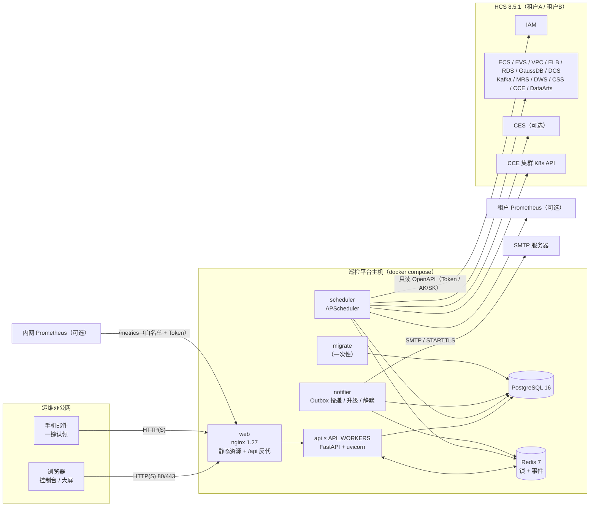
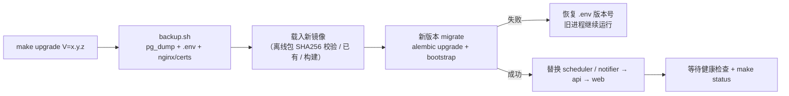
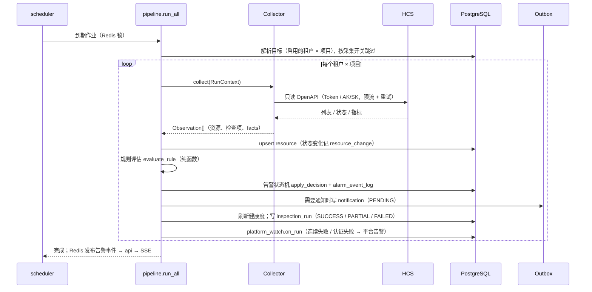
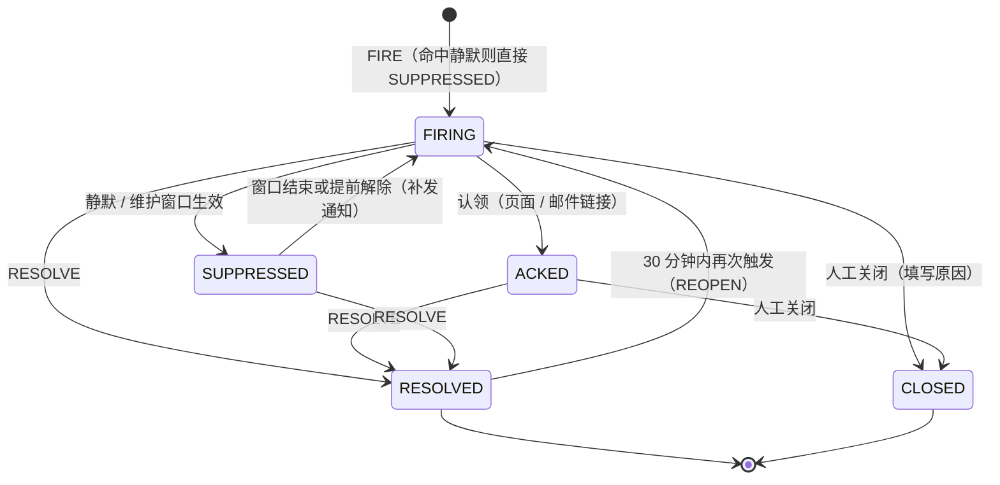

# HCS-Inspector 系统架构文档（v0.4 实现版）

| 项 | 内容 |
| --- | --- |
| 版本 | v0.4.0（2026-10-23） |
| 适配 | Huawei Cloud Stack 8.5.1，两个租户（账号密码 IAM Token / AK/SK 签名各一） |
| 定位 | 运维组内部使用的**只读**巡检、告警、台账、报表平台 |
| 部署 | 单机 docker compose（1 台 Linux 虚拟机） |
| 与 V1.0 设计的关系 | 《系统架构与详细设计 V1.0》是目标架构；本文描述**代码实际实现**，差异见第 13 章 |

## 1 概述

### 1.1 要解决的问题

HCS 上 DataArts Studio 作业、MRS、GaussDB、DCS、ECS、CCE 等服务的运行状态分散在各自控制台，值班需要来回切换；人工巡检依赖经验，夜间和节假日容易漏；
资源（负责人、业务系统）没有统一台账；日报 / 周报靠手工整理。平台把这些工作自动化：

| 能力 | 实现 |
| --- | --- |
| 巡检告警 | 8 个巡检任务定时采集 → 35 条内置规则判定 → 告警去重 / 升级 / 恢复 → 邮件通知（手机端一键认领）→ 未认领按级别升级 |
| 容器事件 | CCE 集群 K8s API 采集 Pod 状态与 Event，归类为 10 类（重启、OOM、CrashLoop、背压、驱逐、探针失败、调度失败、镜像拉取失败、节点压力、扩缩容）+ 其他 Warning，聚合并告警 |
| 资源台账 | 每小时同步 14 类资源；管理字段（负责人、业务系统、环境、核心、备注）页面维护 + 字典 + Excel 导入；新增 / 变更 / 释放 / 状态变化留痕 |
| 报表中心 | 日报 / 周报 / 月报 / 台账报表，按租户或合并；定时邮件（正文摘要 + Excel 附件） |
| 运维配置 | 维护与静默、采集开关、巡检任务周期、通知路由 / 联系人、系统设置（数据保留、平台告警），全部页面操作、即时生效、写审计 |
| 平台看护 | 平台自身告警（任务连续失败、认证失败、通知失败、进程心跳超时）、`/metrics`、`make status` |

### 1.2 设计原则

1. **对 HCS 只读**：只调用查询类 OpenAPI；HCS 账号只授予只读权限；平台内的“关闭告警、释放判定”等都只改平台自己的数据。
2. **单机可运维**：一套镜像、一个 compose 文件、一个 `.env`；安装、升级、备份、恢复都是一条 `make` 命令；不引入 K8s、消息队列、时序库。
3. **故障不扩散**：按“租户 × 项目”逐个执行，某个租户 / 某类资源失败不影响其他；接口异常时不做“释放 / 恢复”判定，避免误报。
4. **配置即数据**：运维会改的东西（周期、开关、静默、路由、保留天数、报表时间）都在页面维护、存数据库、30 秒内生效；环境变量只放部署级配置和密钥。
5. **可审计、可追溯**：写操作全部进 `audit_log`；告警每次状态变化写 `alarm_event_log`；台账每次变化写 `resource_change`。

### 1.3 范围外

SSO / LDAP、短信 / IM / SMN 通道、值班排班表、ManageOne 北向告警、CTS 审计事件、时序库与容量预测、对 HCS 的任何变更操作（如释放资源）。规划见《后期开发方案》。

## 2 总体架构

- **api**：REST 接口（97 个）、登录鉴权、RBAC、SSE 推送、`/metrics`；无状态，可多进程（`API_WORKERS`，默认 2）。
- **scheduler**：按任务周期 / crontab 执行巡检、台账同步、数据清理、定时报表；单副本（Redis 锁防重）。
- **notifier**：轮询 Outbox 发邮件、失败退避重试、未认领升级、静默到期补发、心跳互相看护。
- **migrate**：每次安装 / 升级时先运行：`alembic upgrade head` + 幂等初始化（内置角色、规则、任务；首次创建 admin）。
- **web**：nginx 承载前端静态资源，`/api/` 反代到 api，SSE 不缓冲，访问白名单、安全响应头、HTTPS（叠加文件）。

## 3 部署视图

### 3.1 容器与资源

| 服务 | 镜像 | 端口 | 数据 / 挂载 | 健康检查 | 依赖 |
| --- | --- | --- | --- | --- | --- |
| postgres | postgres:16-alpine | 不暴露 | `${DATA_DIR}/postgres` | `pg_isready` | — |
| redis | redis:7-alpine（AOF + RDB） | 不暴露 | `${DATA_DIR}/redis` | `redis-cli ping` | — |
| migrate | hcs-inspector-backend | — | — | 一次性，成功退出 | postgres healthy |
| api | hcs-inspector-backend | 不暴露（8000，仅容器网络） | `exports:/app/data`、`./certs:/app/certs:ro` | `/readyz`（查库） | migrate 完成、redis healthy |
| scheduler | hcs-inspector-backend | — | 同 api | `python -m app.tools.status --check scheduler`（心跳） | api healthy |
| notifier | hcs-inspector-backend | — | 同 api | `python -m app.tools.status --check notifier`（心跳） | api healthy |
| web | hcs-inspector-web（nginx 1.27-alpine） | `${WEB_BIND}:${WEB_PORT:-80}`；HTTPS 叠加 443 | `nginx/http.conf`、`nginx/snippets/` | `/nginx-health` | api healthy |

- 后端 4 个服务共用一个镜像（python:3.12-slim，非 root 运行），按启动命令区分进程；依赖版本由 `backend/constraints.txt` 锁定。
- 日志：Docker json-file，单文件 50 MB × 5 个轮转；后端输出 JSON 结构化日志（含 `request_id`）。
- 推荐规格：4 核 8 GB、数据盘 100 GB（两个租户、数千个资源、默认保留天数下数据库约数 GB 量级）。
- 叠加文件：`docker-compose.https.yml`（443 + 证书）、`docker-compose.demo.yml`（Mock HCS + Mailpit + 演示数据，仅演示）、`docker-compose.build.yml`（源码构建），由 `.env` 的 `COMPOSE_FILE` 组合。

### 3.2 网络访问关系

| 方向 | 协议 / 端口 | 说明 |
| --- | --- | --- |
| 运维办公网 → 平台 | HTTP 80 / HTTPS 443 | 可用 `nginx/snippets/allowlist.conf` 限定来源网段 |
| 平台 → 各租户 IAM、服务 Endpoint | HTTPS 443 | 内部 CA 放 `certs/`，配置 `INSPECTOR_HCS_CA_FILE` 校验证书 |
| 平台 → CCE 集群 K8s API | HTTPS（集群 API 端口） | 需集群只读 RBAC；不通时容器事件采集记为 WARN，其他功能不受影响 |
| 平台 → 租户 Prometheus | HTTP(S) | 仅“指标来源 = Prometheus”的租户 |
| 平台 → SMTP | 25 / 465 / 587 | 支持 STARTTLS、内部 CA |
| 内网 Prometheus → 平台 `/metrics` | HTTP(S) | nginx 默认拒绝，`metrics-allow.conf` 放行 + `Authorization: Bearer` |

### 3.3 发布与升级

迁移脚本保持**向前兼容**（只加表 / 加可空列，不在同一版本删除旧列），因此“先迁移、后替换进程”期间旧版本进程仍可运行。回滚方式：`make rollback V=<旧版本> F=<升级前备份>`（改回版本号 → 恢复升级前数据库 → 启动旧版本）。

## 4 进程模型与定时机制

| 进程 | 周期 | 动作 |
| --- | --- | --- |
| scheduler | 按任务 `interval_sec` 或 `cron` | 执行巡检任务 / `ledger_sync` / `data_cleanup`：`max_instances=1`（不重叠）、`coalesce`（错过合并）、`jitter`（打散请求）；Redis 锁保证同一作业同一时刻只在一处执行 |
| scheduler | 按“定时报表”设置的 crontab | 生成日报 / 周报 / 月报并入 Outbox |
| scheduler | 30 秒 | 同步任务配置（页面修改周期 / 启停 / 报表时间后最迟 30 秒生效）；写心跳（含各作业下次执行时间）；检查 notifier 心跳 |
| notifier | 5 秒 | 取 `PENDING` / 到期 `RETRYING` 的通知发送（PostgreSQL `SKIP LOCKED`，可多副本） |
| notifier | 60 秒 | 未认领升级扫描；静默 / 维护窗口生效与结束（结束后仍未恢复的告警补发通知）；检查 scheduler 心跳 |
| notifier | 30 秒 | 写心跳（含待发数量） |
| api | 请求驱动 | REST / SSE；进程启动时订阅 Redis 频道 `inspector:alarms`，把调度 / 通知进程产生的告警事件转发给 SSE 订阅者 |

内置任务（`bootstrap` 写入，页面可改周期 / 启停）：

| 代码 | 名称 | 默认周期 | 服务 |
| --- | --- | --- | --- |
| `dgc_realtime_status` | DataArts 实时作业状态 | 60 秒 | DataArts Studio |
| `dgc_batch_instance` | DataArts 批作业实例 | 300 秒 | DataArts Studio |
| `mrs_cluster_status` | MRS 集群状态 | 120 秒 | MRS |
| `mrs_job_status` | MRS 作业执行 | 300 秒 | MRS |
| `gaussdb_status` | GaussDB 实例状态与容量 | 120 秒 | GaussDB |
| `dcs_status` | DCS 实例状态与内存 | 60 秒 | DCS |
| `ecs_status` | ECS 云服务器状态与资源使用 | 120 秒 | ECS（CPU / 内存 / 磁盘指标来自 CES / Prometheus） |
| `cce_pod_events` | CCE 容器事件采集 | 60 秒 | CCE（K8s API） |
| `ledger_sync` | 资源台账同步 | 3600 秒 | 14 类资源 |
| `data_cleanup` | 数据清理（按保留期删除过期数据） | crontab `30 3 * * *` | 平台 |

## 5 模块划分

### 5.1 后端（`backend/app`，约 13.3K 行）

| 包 | 职责 |
| --- | --- |
| `api/v1` | 路由：auth、dashboard、alarms、silences、resources（台账）、pod_events、rules、notify、reports、system（任务 / 采集开关 / 设置 / 平台状态 / 审计）、tenants、users、stream（SSE）；`api/metrics.py`（Prometheus） |
| `core` | 配置（`Settings` + 生产自检 `ensure_prod_ready`）、数据库（`UtcDateTime`）、统一响应与错误码、JWT / 口令 / 票据 / 邮件链接签名、权限点与内置角色、依赖（当前用户、`require_perm`、数据范围）、审计、JSON 日志 + request_id、AES-256-GCM、事件总线、HTTP 指标 |
| `hcs` | HCS 客户端：`TokenAuth` / `AkSkAuth`、SDK-HMAC-SHA256 签名、Endpoint 模板解析、按服务令牌桶限流、401 刷新、429/5xx 指数退避重试、分页 |
| `collectors` | 巡检采集器（DataArts 实时 / 批、MRS 集群 / 作业、GaussDB、DCS、ECS），输出标准化 `Observation`；`registry.TASKS` 注册 |
| `k8s` | CCE 容器事件：K8s pods / events 拉取、事件归类、工作负载推断、聚合、背压探针 |
| `metrics` | 指标来源：CES / Prometheus，按租户能力自动选择与降级 |
| `rules` | 规则模型（state / threshold）、安全表达式求值、评估器（纯函数）、默认规则 YAML 加载 |
| `services` | 巡检流水线、告警服务（状态机）、静默、采集开关、系统设置、数据清理、平台看护、总览、租户解析与连通性测试、资源目录、初始化与演示数据 |
| `ledger` | 台账拉取（`FETCHERS`，14 类）、同步比对、Excel 导出、Excel 导入（预览 / 确认） |
| `notify` | 路由匹配、收件人解析、未认领升级、邮件渲染（Jinja2 模板）、SMTP、Outbox 投递 |
| `reports` | 报表统计（按租户 / 合并）、Excel 生成、生成与发送服务 |
| `workers` | 进程入口：`scheduler`、`notifier`、`run_once`（手动执行）、`bootstrap`（幂等初始化） |
| `tools` | 运维工具：`probe`（HCS 接口探测）、`status`（平台自检）、`apidoc`（接口清单生成） |
| `models` / `schemas` | SQLAlchemy 2 模型 / Pydantic 2 请求与响应模型 |
| `mock_hcs`（同级目录） | Mock HCS 8.5.1：两个租户的 IAM、各服务查询接口、CES、Prometheus、CCE K8s API（开发 / 测试 / 演示） |

### 5.2 前端（`frontend/src`，约 9.5K 行，47 个 `.vue`）

| 目录 | 内容 |
| --- | --- |
| `views` | 运行总览、告警中心、容器事件、资源台账、规则管理、通知管理、维护与静默、报表中心、系统管理（租户接入、采集开关、巡检任务、平台状态、用户管理、角色与权限、系统设置、操作审计 8 个页签）、态势大屏、登录、手机端告警处理页 |
| `api` / `types` | 接口封装（axios，统一信封解析、错误提示）与 TypeScript 类型 |
| `stores` | Pinia：用户（权限点 `can` / `canAny`、租户范围）、应用（租户切换、主题） |
| `router` / `config/menu.ts` | 路由 `meta.perm` 守卫、菜单按权限显示 |
| `directives` | `v-perm`（无权限移除按钮；接口层仍校验） |
| `composables` | `useAlarmStream`（SSE：换票据 → 连接 → 断线重连）、`useTable`（分页查询） |
| `components` | 图表（ECharts 按需）、级别 / 状态 / 健康度 / 租户标签、页头、统计卡、改密 |

技术要点：Element Plus 通过 `unplugin-vue-components` 按需引入（入口 chunk gzip 约 102 KB），ECharts 单独 chunk；所有页面懒加载。

## 6 数据模型

PostgreSQL 16（开发可用 SQLite），Alembic 管理迁移（0001 初始化 → 0002 多租户 / RBAC / 审计 / 容器事件 → 0003 静默 / 采集开关 / 系统设置 / 心跳）。共 **25 张表**。
时间一律 UTC 存储（`UtcDateTime` 类型）、ISO 8601 传输、前端按平台时区显示；JSON 列在 PostgreSQL 上为 JSONB。

| 领域 | 表 | 说明 |
| --- | --- | --- |
| 租户 | `hcs_account`、`hcs_project` | 租户（认证方式、IAM 地址、Domain、加密凭据 `secret_cipher`、指标来源、能力探测结果、报表收件人）与项目（唯一外键 → `hcs_account`） |
| 资源 | `resource`、`resource_change` | 统一资源表（巡检对象 + 台账，`attrs` / `metrics` JSON，管理字段，健康度，生命周期 `lifecycle` / `deleted_at`）；变更记录（类型 CREATED / UPDATED / DELETED / STATUS / REBOOT，来源 SYNC / MANUAL / IMPORT / INSPECT，字段级 old / new） |
| 巡检 | `inspection_task`、`inspection_run`、`eval_state` | 任务定义（周期 / cron / 启停 / 参数）；每次执行（按租户一条，状态、耗时、统计、错误）；规则评估中间状态（连续命中 / 恢复次数） |
| 规则告警 | `alarm_rule`、`alarm_event`、`alarm_event_log`、`alarm_silence` | 规则（版本号）；告警（指纹去重、级别、状态、抑制原因、所属静默、认领人、复发次数）；告警时间线；静默 / 维护窗口（匹配条件、循环、累计抑制数） |
| 容器 | `pod_event`、`pod_state`、`pod_probe` | 容器事件（类型、级别、开始 / 结束、次数）；Pod 上次状态（重启计数比对）；背压探针配置 |
| 通知 | `notification`、`notify_route`、`contact_group`、`contact` | Outbox（PENDING / RETRYING / SENT / FAILED / MERGED）；路由（匹配条件、联系组、升级规则、优先级、是否继续匹配）；联系组（成员、组长）；联系人 |
| 报表 | `report` | 报表记录（类型、范围、周期、摘要、Excel 附件、发送状态） |
| 平台 | `sys_user`、`sys_role`、`audit_log`、`sys_setting`、`collect_switch`、`worker_heartbeat` | 用户（PBKDF2 口令、锁定、租户范围）；角色（权限点列表）；操作审计；系统设置（键 → JSON）；采集开关（租户 × 资源类型，`tenant_id=0` 为全局）；进程心跳 |

除 `hcs_project → hcs_account` 外不建数据库外键（`tenant_id`、`resource_ref`、`alarm_id` 为逻辑关联），便于分批清理与历史数据保留；查询所需索引在迁移中建立。

## 7 关键流程

### 7.1 巡检流水线

- 指纹 = 租户 + 规则 + 资源 + 子对象，同一指纹只有一条活动告警。
- 局部失败（某个工作空间 / 集群）记为 PARTIAL，其余结果照常处理；HCS 认证失败（401 / 403）立即产生 R-PLAT-002。
- 缺少数据（`MissingFact`）时“保持现状”，不触发也不恢复，避免接口抖动造成误恢复。

### 7.2 规则与告警状态机

规则两类：`state`（表达式匹配状态，如 `status == 'ERROR'`）与 `threshold`（多级阈值，如内存 ≥ 85 % P3、≥ 95 % P1）；`for_count` 连续命中 N 次才触发；
`recover` 支持恢复条件或回差（如低于 75 % 才恢复）；每条规则带 `runbook`（处置建议，显示在告警详情和邮件中）。内置 35 条：DGC 8、ECS 7、DCS 6、GaussDB 5、CCE 5、MRS 4；另有平台规则 R-PLAT-001 ~ 004。

评估器输出动作：`FIRE` 新告警、`UPGRADE` / `DOWNGRADE` 级别变化、`REFRESH` 持续中、`RESOLVE` 恢复。

- 活动状态 = FIRING / ACKED / SUPPRESSED；已认领的告警不会被静默（避免处理中的告警“消失”）。
- 升级（UPGRADE）会重新通知；采集开关关闭某类资源时，其活动告警被关闭并记录原因。

### 7.3 通知与未认领升级

1. 告警需要通知时写 Outbox（`notification`，PENDING），与告警状态变更在同一事务内，进程崩溃不丢通知。
2. notifier 每 5 秒取待发记录，按**通知路由**（优先级顺序匹配租户 / 服务 / 级别 / 资源类型，可“继续匹配”）解析联系组成员 → 渲染 HTML + 纯文本邮件 → SMTP 发送。
3. 失败按 1 / 5 / 15 / 30 / 60 分钟退避重试；第 5 次仍失败置为 FAILED，并产生 R-PLAT-003。
4. 邮件里的“认领”链接带 HMAC 签名（告警 + 动作 + 收件人 + 过期时间，24 小时有效），手机打开 `/m/action/:token` 即可认领，无需登录；链接只允许认领。
5. 未认领升级：路由的 `escalation` 规则（如 P1 / P2 15 分钟未认领通知组长），notifier 每分钟扫描，每级只升级一次，认领 / 恢复后停止。
6. 路由模拟（通知管理 → 路由模拟）：输入租户 / 服务 / 级别，查看命中路由、收件人、升级计划、是否被静默。

### 7.4 维护与静默

- 匹配条件（全部满足）：租户、服务、资源类型、规则、级别、具体资源、指纹、名称关键字；类型：静默（已知问题）/ 维护窗口（计划内变更）。
- 时间：一次性（最长 31 天）或按周循环（每周几 + 时段，最长 366 天），按平台时区计算。
- 生效：新告警命中 → 直接 SUPPRESSED（不通知、不升级）；notifier 每分钟把命中的 FIRING 告警转为 SUPPRESSED；
  结束 / 提前解除 → 仍未恢复的告警转回 FIRING，写 `UNSILENCE` 日志并补发通知。
- 创建前可预览命中的活动告警；告警详情“快速静默”（只这条告警 / 该资源全部告警 / 该租户下这条规则，静默 N 分钟）；`silence:manage` 权限控制。

### 7.5 采集开关

全局（`tenant_id = 0`）+ 租户覆盖两级，粒度为资源类型。关闭后：对应巡检任务和台账类型跳过该租户（已有台账保留、**不判定为已释放**）、关闭该类资源的活动告警；
保存前预估影响（哪些“租户 · 资源类型”停止 / 恢复、将关闭多少告警）。用于新租户分批接入、某服务接口异常时临时停采。

### 7.6 资源台账同步

1. 按“租户 × 项目”调用 14 个 fetcher，得到标准化 `LedgerRecord`。
2. 与本项目范围内的台账逐条比对：新增 → CREATED；关键字段变化 → UPDATED（记录字段级 old / new）；台账有而接口没有 → DELETED（生命周期标记为已释放，保留期后清理）；ECS 状态变化 / 重启 → STATUS / REBOOT。
3. 保护：某类资源拉取失败则整类跳过、不做释放判定；接口返回空而台账中该类资源超过 3 条，视为异常跳过（`EMPTY_GUARD`）。
4. 管理字段只由页面 / Excel 导入维护，同步不覆盖；字典（业务系统、负责人）可设为强制。
5. 疑似闲置：云硬盘未挂载（available）、EIP 未绑定（DOWN）、ECS 已关机（SHUTOFF）在台账汇总和报表中列出，供人工确认；平台不做释放操作。

### 7.7 容器事件

K8s `pods` 与 `events` 两路：Pod 状态比对重启计数与 `lastState`（重启、OOM、CrashLoop）；Event 按 reason / message 归类（镜像拉取失败、探针失败、驱逐、调度失败、节点压力、扩缩容、背压 …）。
同一 Pod 同类事件聚合计数；持续型事件（CrashLoop、背压）有开始 / 结束；背压按关键字正则识别，`pod_probe` 可配置探针；容器事件保留天数由数据保留设置控制。

### 7.8 报表

日报 / 周报 / 月报包含：健康分、新增 / 恢复 / 未结束告警（按级别 / 服务 / 租户）、认领率与 MTTA / MTTR、重点告警、容器事件（重启 / OOM / CrashLoop / 背压 / 驱逐）、巡检成功率、台账变化与闲置、容量现状（vCPU / 内存 / 存储），并与上一周期对比；台账报表导出全量资源。范围为单个租户或“合并”。
scheduler 按“定时报表”crontab 生成并写 Outbox（正文摘要 + Excel 附件），租户报表发给租户收件人，合并报表发给设置里的收件人；支持手动生成、导出、补发。

### 7.9 平台自身告警与自检

| 规则 | 触发 | 恢复 |
| --- | --- | --- |
| R-PLAT-001 任务连续失败 | 同一任务同一租户连续失败 N 次（默认 3） | 下一次成功 |
| R-PLAT-002 租户认证失败 | IAM / 签名返回 401 / 403 | 下一次认证成功 |
| R-PLAT-003 通知发送失败 | 通知重试 5 次仍失败 | 之后有通知发送成功 |
| R-PLAT-004 进程心跳超时 | scheduler / notifier 超过 N 分钟（默认 3）无心跳，两个进程互相看护 | 心跳恢复 |

平台告警走同一套告警 / 通知链路（服务名“巡检平台”）；没有路由命中时发给“系统设置 → 平台自身告警 → 兜底收件人”，为空则发给有邮箱的平台管理员。
`make status`（`app.tools.status`）一屏输出心跳、通知积压、任务健康、平台告警、迁移版本，异常退出码 1；scheduler / notifier 的容器健康检查也用它。

### 7.10 数据清理

`data_cleanup` 每天 03:30 按“系统设置 → 数据保留”删除过期数据（每批 2000 行、逐批提交），活动告警、在用资源、未结束容器事件不删；各表删除行数写入运行记录。

| 数据 | 默认保留 | 可设范围（天） |
| --- | --- | --- |
| 巡检 / 同步运行记录 | 90 | 7 ~ 3650 |
| 通知发送记录 | 90 | 7 ~ 3650 |
| 已结束告警（含时间线） | 180 | 30 ~ 3650 |
| 操作审计 | 180 | 90 ~ 3650 |
| 台账变更记录 | 365 | 30 ~ 3650 |
| 已释放资源 | 365 | 30 ~ 3650 |
| 历史报表 | 365 | 30 ~ 3650 |
| 容器事件 | 30 | 1 ~ 365 |

## 8 HCS 接入层

| 项 | 实现 |
| --- | --- |
| 认证 | 每租户二选一：账号密码（IAM `POST /v3/auth/tokens`，Token 缓存、提前 1 小时刷新、401 强制刷新一次）；AK/SK（SDK-HMAC-SHA256 每请求签名，项目级带 `X-Project-Id`） |
| 凭据 | 页面录入 → AES-256-GCM（`INSPECTOR_MASTER_KEY`）加密存 `secret_cipher`；接口、日志、审计、探测报告均不返回明文 |
| Endpoint | 全局模板（`INSPECTOR_HCS_ENDPOINTS`，如 `dcs.{region}.{domain}`，也可写完整 URL）+ 租户覆盖；CCE K8s API 模板带 `{cluster_id}` |
| 证书 | 默认校验；内部 CA 通过 `INSPECTOR_HCS_CA_FILE` 指定（不建议关闭校验） |
| 限流与重试 | 按服务令牌桶（默认 5 QPS，CES / K8s API 10 QPS，`hcs/factory.py` 的 `DEFAULT_QPS`）；429 / 5xx 指数退避重试 3 次；请求超时 10 秒（连接 5 秒）；调用计数写入运行统计 |
| 分页 | 统一 `page_all`：offset（记录偏移）/ page（页码）两种模式，按空页、不足一页、达到 total 结束，最多 200 页防死循环 |
| 指标来源 | 每租户“自动 / CES / Prometheus / 无”；自动时连通性测试探测 CES，失败用 Prometheus，都没有只做状态巡检（ECS 状态、容器事件不受影响） |
| 能力探测 | 租户接入“连通性测试”：IAM 认证、项目、各服务可用性、CES / Prometheus、CCE K8s API，结果存 `hcs_account` |
| 联调工具 | `make probe`：逐个调用 22 个接口，核对必需 / 可选字段、状态取值分布（见《联调手册》） |

## 9 安全设计

| 方面 | 实现 |
| --- | --- |
| 登录 | 平台自有用户名 + 口令（PBKDF2-SHA256 20 万次迭代 + 随机盐）；连续输错 5 次锁定 10 分钟（可配）；JWT HS256，默认 12 小时，勾选“7 天内免登录”为 7 天；令牌只含身份，停用 / 改权限即时生效 |
| 权限 | 28 个权限点、8 个模块；内置角色 admin / ops_lead / oncall / viewer + 自定义角色；后端 `require_perm`，前端路由 `meta.perm` + `v-perm`；`tests/test_apidoc.py` 保证写接口都声明权限点 |
| 数据范围 | 用户可限定租户；请求头 `X-Tenant-Id`（顶部租户切换）与用户范围取交集，越权 403；SSE、报表、导出同样过滤 |
| 审计 | 全部写操作写 `audit_log`（操作人、IP、对象、结果、变更前后）；口令、SK 不入审计；保留期不少于 90 天 |
| 密钥 | `gen-env.sh` 随机生成数据库口令、JWT 密钥（32 字节）、邮件链接密钥、`/metrics` 令牌、凭据主密钥、admin 初始口令；`.env` 权限 600，随备份包保存 |
| 生产自检 | `INSPECTOR_ENV=prod` 时：默认 / 过短 JWT 密钥（< 32）、邮件链接密钥（< 16）、缺少 `MASTER_KEY`、使用 SQLite → 拒绝启动；演示数据强制关闭；登录页不显示任何账号 |
| SSE | 先用登录令牌换 60 秒、一次性票据（已用记录存 Redis，多进程共享），令牌不出现在 URL / 访问日志 |
| 邮件链接 | HMAC-SHA256 签名，24 小时过期，绑定收件人，只能认领 |
| 传输与边界 | nginx 安全头（`X-Content-Type-Options`、`X-Frame-Options: SAMEORIGIN`、`Referrer-Policy`、HTTPS 时 HSTS）；来源白名单；`/metrics` 默认拒绝；请求体 20 MB 上限；API 不直接暴露端口 |
| 对 HCS | 只读账号 / AK；只调用 GET 类接口（IAM 认证除外）；探测报告默认脱敏 |

## 10 可观测性

| 手段 | 内容 |
| --- | --- |
| 日志 | JSON（`ts`、`level`、`logger`、`msg`、`request_id`、`method`、`path`、`status`、`cost_ms`、`task`、`project`）；`make logs S=api` |
| 健康检查 | `/healthz`（进程）、`/readyz`（数据库）、`/nginx-health`；scheduler / notifier 用心跳 |
| 指标 | `/metrics`（前缀 `hcs_inspector_`）：`info`、`alarms_active`、`alarms_fired_24h`、`notifications_backlog`、`notifications_24h`、`notification_oldest_pending_seconds`、`task_last_run_timestamp_seconds`、`task_last_success_timestamp_seconds`、`task_last_duration_seconds`、`task_last_status`、`task_consecutive_failures`、`worker_heartbeat_age_seconds`、`resources`、`silences_active`、`sse_subscribers`、`http_requests_total`、`http_request_duration_seconds`（直方图）；清单与告警规则示例见《部署运维手册》“监控对接” |
| 自检 | `make status`；页面“系统管理 → 平台状态” |
| 自身告警 | R-PLAT-001 ~ 004（7.9） |

## 11 配置体系

| 层级 | 存放 | 内容 | 生效 |
| --- | --- | --- | --- |
| 部署配置 | `deploy/.env` | 版本、端口、数据目录、数据库、密钥、SMTP、HCS 全局 Endpoint 模板 / CA、时区、日志 | `make up` 重建容器 |
| 业务配置 | 数据库（页面） | 租户接入、采集开关、巡检任务周期、规则、通知路由 / 联系人、静默、定时报表、数据保留、平台告警、台账字典、用户角色 | 即时或 ≤ 30 秒 |
| 默认值 | 代码 + 环境变量 | 规则 YAML（`backend/app/rules/default_rules.yaml`）、内置任务（`app/services/bootstrap.py`）、`INSPECTOR_REPORT_CRON` 等（仅作初始值，页面保存后以数据库为准） | 首次初始化 |

## 12 技术选型

| 层 | 选型（锁定版本） | 说明 |
| --- | --- | --- |
| 后端 | Python 3.12（镜像）/ 3.13（开发）、FastAPI 0.156、Pydantic 2.14、SQLAlchemy 2.1、Alembic 1.20、uvicorn 0.54、httpx 0.28、APScheduler 3.11、redis-py 8.1、psycopg 3.3、Jinja2、openpyxl | 依赖锁定 `backend/constraints.txt` |
| 前端 | Vue 3.5、TypeScript 5.6、Vite 6、Element Plus 2.9（按需）、Pinia、ECharts 5.5、axios、dayjs | |
| 存储 | PostgreSQL 16、Redis 7 | Redis 只做锁与事件转发，丢失不影响数据 |
| 部署 | Docker 20.10+ / compose v2、nginx 1.27 | 单机 |
| 质量 | ruff、mypy、pytest（102 个用例）、vue-tsc；GitLab CI：check → build（镜像）→ package（离线包） | |

## 13 与 V1.0 设计的差异

| 方面 | V1.0 设计 | v0.4 实现 | 原因 |
| --- | --- | --- | --- |
| 部署 | Docker + Kubernetes（或 2 台虚机 + systemd），调度主备、Worker 多实例、PG 主备、Redis 哨兵 | **单机 docker compose**，K8s 清单与 Helm 删除 | 内部平台、两个租户，规模小；单机 + 每日备份满足要求，运维成本最低 |
| 登录 | 对接 LDAP / SSO | 平台自有用户名 + 口令 | 使用方仅运维组；无需依赖外部身份系统 |
| 任务分发 | Redis Stream / Celery 队列 + Worker | scheduler 进程内执行（APScheduler + Redis 锁），按租户串行 | 任务量小（10 个任务 × 2 个租户），省去队列组件 |
| 通知渠道 | 邮件 + SMN / IM Webhook / 短信 | 邮件（SMTP），HTML + 纯文本，手机一键认领 | 先满足主通道；其他渠道列入后续 |
| 值班与降噪 | 值班排班表、group_wait 分组等待、风暴模式 | 通知路由 + 联系组 / 组长 + 未认领升级；静默 / 维护窗口；指纹去重 + 30 分钟复发重开 | 先覆盖高频场景；排班和风暴模式列入后续 |
| 角色 | 平台管理员、运维值班、服务负责人、只读访客；按项目 / 资源组隔离 | admin、ops_lead、oncall、viewer + 自定义角色；按**租户**隔离 | 与“多租户接入”一致 |
| 平台自监控 | R-SYS-001 ~ 006 | R-PLAT-001 ~ 004 + `/metrics` + `make status` | 合并同类项，聚焦可操作的 4 类 |
| 时序库 / 报表 | VictoriaMetrics（可选）、健康分、SLA、容量预测 | 不引入时序库；报表含健康分、MTTA / MTTR、成功率、容量现状与环比，无容量预测 | 指标直接取 CES / Prometheus；趋势预测列入后续 |
| 开放接口 | Webhook 推送、ITSM 创建静默 | REST 接口（97 个，权限控制）；无对外 Webhook | 列入后续 |
| 指标来源 | CES | CES 优先 → Prometheus → 仅状态巡检，按租户自动探测 | 两个租户能力不同 |
| 新增 | — | 容器事件、资源台账、采集开关、平台设置、HCS 探测工具、离线安装包 | 运维实际需求 |

## 14 容量与性能

- 两个租户、每租户数百到数千资源：单次巡检任务秒级到数十秒（受 HCS 接口延迟与限流影响），`ledger_sync` 分钟级；scheduler 单进程足够。
- 告警评估为纯内存计算；数据库压力主要来自台账同步和报表统计，已建索引并分批清理。
- 扩展方式：API 增加 `API_WORKERS`；HCS 限流按服务调 QPS；若后续租户 > 10 或资源 > 5 万，再考虑把采集拆为多 worker（见《后期开发方案》）。

## 15 已知限制

1. 与真实 HCS 8.5.1 的字段映射按官方 API 文档与 Mock 实现，**需在局域网用 `make probe` 核对**后修正（《联调手册》）。
2. 镜像构建与部署脚本在开发沙箱中仅做静态检查，需在构建机 / 测试机完成一次 `make bundle` → `make install` → `make upgrade` → `make restore` 演练。
3. 单机部署无高可用：主机故障时按“备份恢复”流程在新主机恢复（RPO = 备份间隔，默认 1 天；RTO 约 30 分钟）。
4. `/api/docs` 使用 CDN 版 Swagger UI，离线环境请看 `docs/接口清单.md`。
